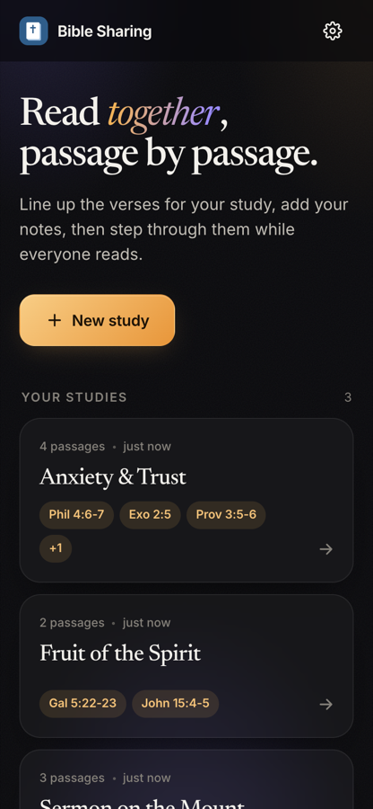
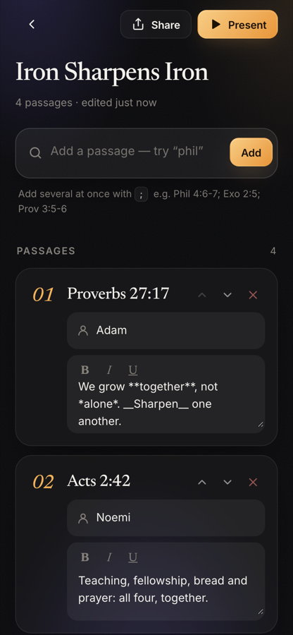
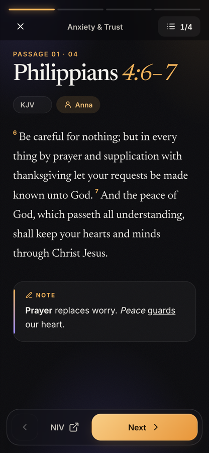
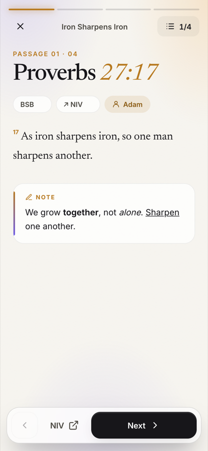

# Bible Sharing Tool

Prepare a list of Bible passages, add notes, and step through them while reading together.

**▶ Use it: [bible.poncethelion.com](https://bible.poncethelion.com)**: works in any browser, installable on your phone, no account needed.

Static PWA: no backend, studies are saved in the browser's localStorage, share links carry the whole study in the URL.

## Privacy

Everything runs in your browser. There is no account, no server and no database, so your studies, notes and readers' names never leave your device, and nobody (including me) can see them.

- **Verse text** is fetched from the [Free Use Bible API](https://bible.helloao.org). Only the translation and chapter (e.g. "BSB, Philippians 4") are sent, never your notes.
- **"Open in"** goes to Bible.com, and only when you tap it.
- **Share links** carry the study inside the link (after the `#`, which browsers never send to a server). Nothing is uploaded, but anyone you send the link to can read it.
- **No ads, no analytics, no tracking.** Fonts are self-hosted; the [Content Security Policy](public/_headers) only allows the app's own files and the Bible API.

**You keep your own data.** Clearing browser data, uninstalling, or switching phones removes your studies. Use **Settings → Export backup** now and then, and **Import backup** to restore or move to another device.

Full text: [Privacy & Terms](https://bible.poncethelion.com/#/legal).

- Verse text: BSB (default) / WEB / KJV, all public domain, from the [Free Use Bible API](https://bible.helloao.org), cached on the device after first view
- Other translations (NIV, ESV, NKJV, NASB…): the "Open in" button opens the passage on Bible.com; pick which one on the reading screen

<p align="center">
  
  
  
  
</p>

## Files

```
public/          ← everything that gets deployed
  index.html     the whole app
  sw.js          offline cache (bump VERSION when shipping changes)
  _headers       Cloudflare headers: security, caching, noindex
wrangler.toml    Cloudflare Workers config (static assets from public/)
```

## Run locally

```sh
npx wrangler dev              # http://localhost:8787
```

## Deploy to Cloudflare

Connected to GitHub: Cloudflare dashboard → Workers & Pages → Create → Import a repository → `rfpdl/bible-sharing-tool`.
Leave the build command empty and keep the deploy command `npx wrangler deploy`. Every push to `main` redeploys.

Or from your machine:

```sh
npx wrangler login            # first time only
npx wrangler deploy
```

Production: [bible.poncethelion.com](https://bible.poncethelion.com) (custom domain on the Worker).

## Install on your phone

Open the site, then:
- iPhone: Safari → Share → Add to Home Screen
- Android: Chrome → ⋮ → Install app

## Credits

Fonts: [Inter](https://rsms.me/inter/) and [Newsreader](https://github.com/productiontype/Newsreader), both SIL Open Font License, self-hosted in `public/fonts`.
